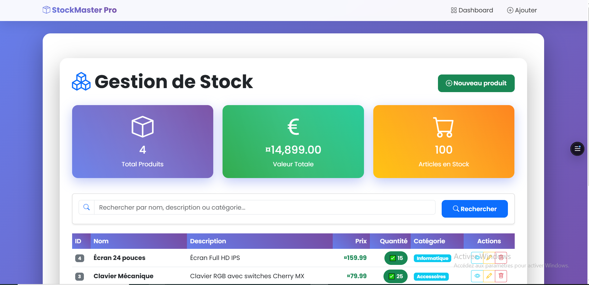
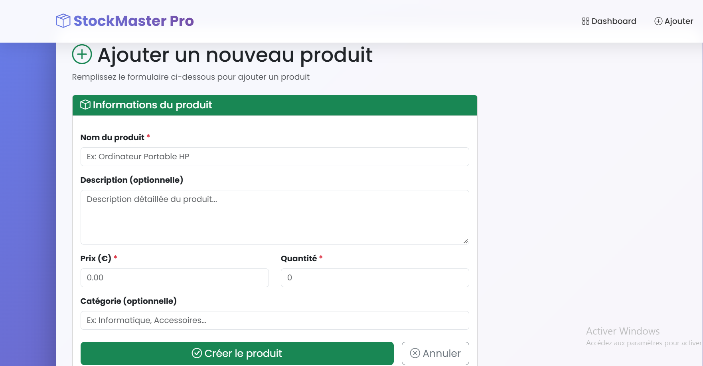

# Gestion de stock — Application ASP.NET Core MVC

Application web de gestion de produits et de stocks développée avec **C#**, **ASP.NET Core MVC**, **Entity Framework Core** et **SQLite**. Elle permet de gérer un catalogue de produits et de consulter des indicateurs récapitulatifs du stock.

## Fonctionnalités

- **Gestion des produits (CRUD) :** créer, consulter, modifier et supprimer des produits.
- **Recherche :** filtrer les produits par nom, description ou catégorie.
- **Vue d’ensemble du stock :** nombre de produits, quantité totale et valeur estimée du stock.
- **Indicateurs de quantité :** mise en évidence des stocks faibles.
- **Informations produit :** nom, description facultative, prix, quantité, catégorie et date de création.
- **Interface responsive :** vues Razor, formulaires et tableaux adaptés à différentes tailles d’écran.
- **Base locale :** SQLite stocke les données dans un fichier.
- **Données de démonstration :** quatre produits d’exemple sont ajoutés au démarrage si la table est vide.

> **Périmètre actuel :** le dépôt porte sur la gestion des produits et des quantités. L’authentification, les rôles, les fournisseurs, les commandes d’achat, les ventes et une API REST dédiée ne sont pas documentés comme fonctionnalités disponibles.

## Technologies

| Technologie | Utilisation |
|---|---|
| C# / .NET 9 | Langage et environnement d’exécution |
| ASP.NET Core MVC | Routage et logique web |
| Entity Framework Core 9 | Accès aux données |
| SQLite | Base de données relationnelle locale |
| Bootstrap 5.3 | Mise en page responsive |
| Bootstrap Icons | Icônes d’interface |
| Razor Views | Génération des pages HTML |
| EF Core Tools / Design | Outils de développement des données |

Le projet `FirstProject.csproj` cible `net9.0`. Bien qu’un fournisseur SQL Server figure également parmi les dépendances, la configuration de démarrage documentée utilise SQLite.

## Pages principales

| Route | Description |
|---|---|
| `/` | Redirection vers la liste des produits |
| `/Products` | Liste et recherche |
| `/Products/Details/{id}` | Détails d’un produit |
| `/Products/Create` | Création |
| `/Products/Edit/{id}` | Modification |
| `/Products/Delete/{id}` | Confirmation de suppression |

## Structure du projet

```text
GestionStock/
├── Controllers/
│   └── ProductsController.cs
├── Models/
│   └── Product.cs
├── dta/
│   └── ApplicationDbContext.cs
├── Migrations/
├── Views/
│   ├── Home/
│   ├── Products/
│   └── Shared/
├── wwwroot/
├── Program.cs
├── FirstProject.csproj
└── FirstProject.sln
```

## Installation et lancement

### Prérequis
- SDK .NET 9
- Git

### Étapes

```bash
git clone https://github.com/WissemAttouf/GestionStock.git
cd GestionStock
dotnet restore
dotnet run
```

Ouvrez l’adresse locale indiquée dans le terminal. Le port dépend de la configuration de lancement.


## 📸 Captures d’écran

<p align="center">
  
  <br><strong>Tableau de bord</strong>
  <br><em>Vue des indicateurs et du résumé du stock.</em>
</p>

<p align="center">
  
  <br><strong>Ajouter un produit</strong>
  <br><em>Formulaire de création d’un produit dans le catalogue.</em>
</p>

---

## Auteur

**Wissem Attouf** — Ingénieur logiciel | Développeur Full Stack  
[GitHub](https://github.com/WissemAttouf) · [LinkedIn](https://www.linkedin.com/in/wissem-attouf-452509226/) · [Portfolio](https://wissem-portfolio.vercel.app/) · [E-mail](mailto:wattouf35@gmail.com)

---
